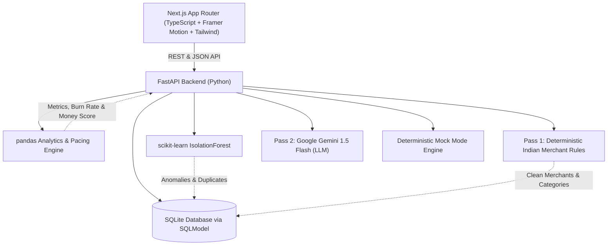
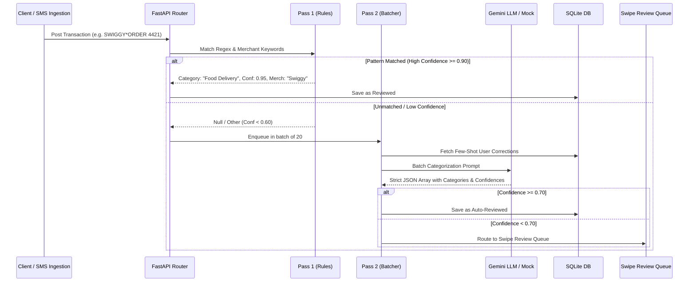
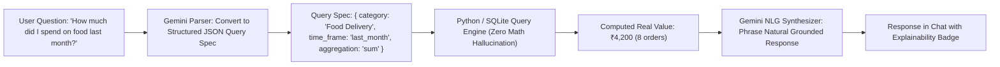
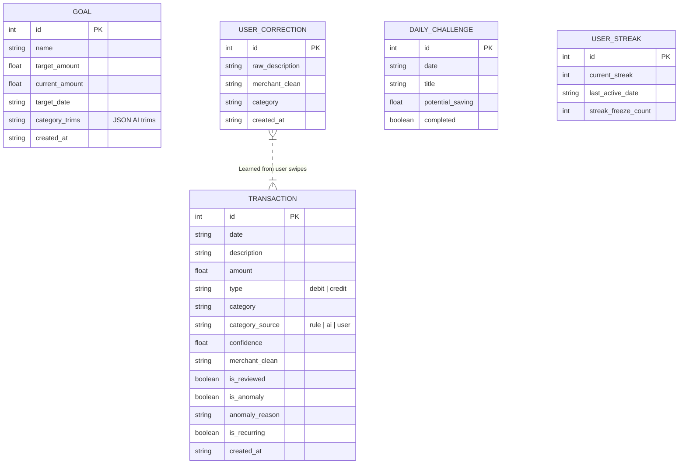

# Rupee Radar: Architecture Specification

Rupee Radar is designed around a decoupled, responsive modern client-server architecture with an explainable AI pipeline tailored to Indian financial workflows (UPI, EMIs, recurring subscriptions, and ₹ currency dynamics).

---

## 1. System Architecture

---

## 2. Hybrid Categorization Pipeline

---

## 3. "Ask Your Money" Natural Language Query Engine

---

## 4. Database Schema (SQLModel / SQLite)

---

## 5. Security & Privacy Safeguards
- **Zero Raw PII Exposure:** Bank account numbers, IFSC codes, mobile numbers, and personal identity strings are stripped before transmission to any external model.
- **Fail-Safe Offline Mode:** In the absence of an internet connection or Gemini API credentials, deterministic mock logic ensures 100% operational functionality without crashing.

